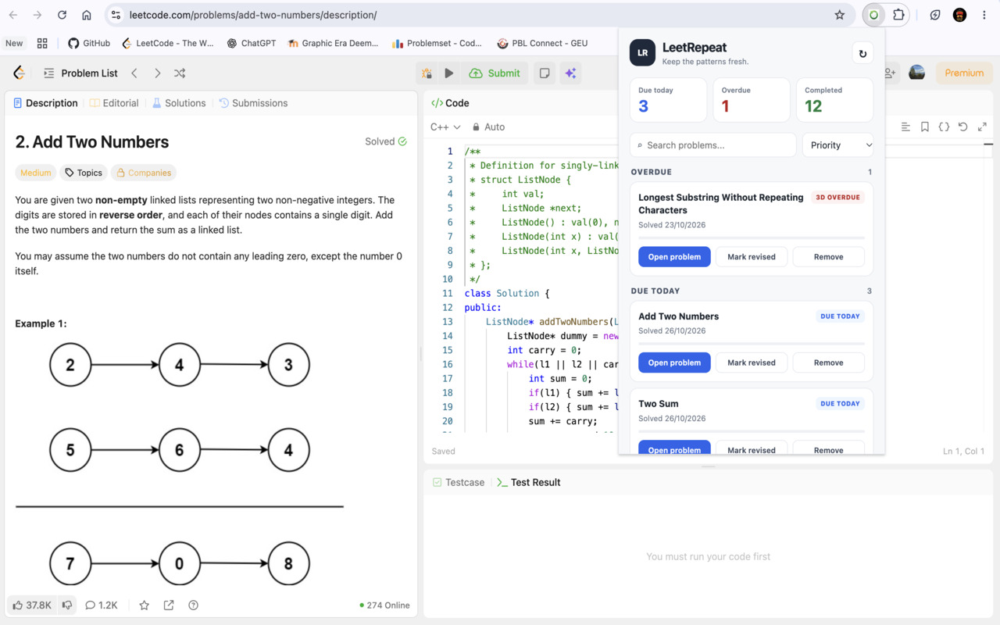
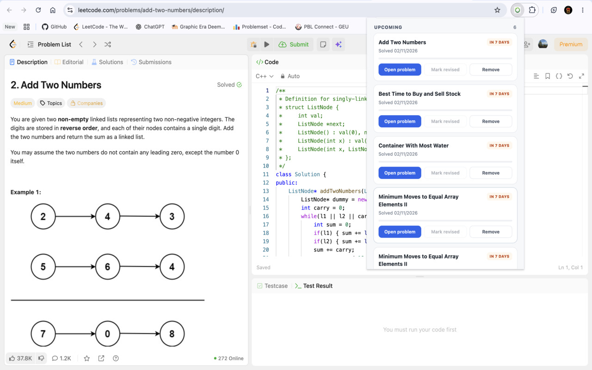
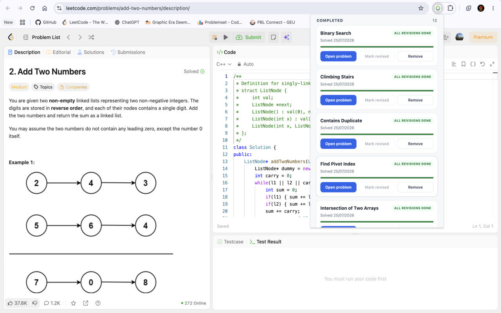

# LeetRepeat

<p align="center">
  
</p>

<p align="center">
  <strong>A Chrome extension for spaced repetition of LeetCode problems.</strong>
</p>

<p align="center">
  Automatically track Accepted submissions and revisit problems at scheduled intervals to improve long-term retention.
</p>

---

## Overview

LeetRepeat helps developers retain their problem-solving knowledge by automatically tracking Accepted submissions on LeetCode and scheduling revision reminders.

Instead of relying on manual tracking, the extension detects successful submissions, stores problem information locally, and reminds users when it is time to revisit previously solved problems.

## Features

- **Automatic Submission Tracking:** Detects Accepted submissions on LeetCode problem pages.
- **Spaced Repetition:** Schedules revision reminders at 7, 30, and 90 days.
- **Revision Dashboard:** View tracked problems and their revision status.
- **Progress Tracking:** Monitor completed, upcoming, due, and overdue revisions.
- **Mark as Revised:** Record completed revision sessions.
- **Persistent Storage:** Retains problem progress across browser sessions.
- **Direct Problem Access:** Open tracked problems directly from the dashboard.
- **Problem Management:** Remove problems from the revision list when no longer needed.
- **Desktop Notifications:** Receive reminders when revisions become due.

## Screenshots

### Revision Dashboard


### Problem Tracking and Revision Status


### Revision Management


## How It Works

1. Open a problem on [LeetCode](https://leetcode.com/).
2. Submit your solution.
3. When the submission is Accepted, LeetRepeat automatically tracks the problem.
4. The extension schedules revision reminders for:
   - 7 days after solving
   - 30 days after solving
   - 90 days after solving
5. Open the extension dashboard when a revision becomes due.
6. Re-solve the problem and mark it as revised.
7. Continue revisiting problems to reinforce long-term retention.

## Installation

### Install from Chrome Web Store

Once published, users will be able to install LeetRepeat directly from the Chrome Web Store.

### Load Locally in Developer Mode

1. Clone the repository:

   ```bash
   git clone https://github.com/ashutosh691/LeetRepeat.git
   ```

2. Open Chrome and navigate to:

   ```text
   chrome://extensions/
   ```

3. Enable **Developer mode**.
4. Click **Load unpacked**.
5. Select the cloned `LeetRepeat` project directory.
6. Open a LeetCode problem page and submit a solution.
7. Click the LeetRepeat extension icon to access the dashboard.

## Technology Stack

| Technology | Purpose |
|---|---|
| JavaScript | Extension logic and UI interactions |
| HTML5 | Popup structure |
| CSS3 | Dashboard styling |
| Chrome Extension Manifest V3 | Extension architecture |
| Chrome Storage API | Local problem and progress storage |
| Chrome Alarms API | Scheduling revision reminders |
| Chrome Notifications API | Displaying revision notifications |
| MutationObserver | Detecting changes in LeetCode submission results |

## Project Structure

```text
LeetRepeat/
├── manifest.json
├── background.js
├── content.js
├── popup.html
├── popup.css
├── popup.js
├── icon16.png
├── icon48.png
├── icon128.png
├── screenshot1.jpg
├── screenshot2.jpg
├── screenshot3.jpg
├── PRIVACY.md
└── README.md
```

## Privacy

LeetRepeat stores tracked problems and revision progress locally using Chrome Storage.

The extension does not require a LeetCode account password and does not use a separate backend server to store revision data.

For more information, see the [Privacy Policy](PRIVACY.md).

## Permissions

LeetRepeat uses the following Chrome permissions:

| Permission | Purpose |
|---|---|
| `storage` | Save tracked problems and revision progress |
| `alarms` | Schedule revision reminders |
| `notifications` | Notify users when revisions are due |

The extension accesses LeetCode problem pages to detect Accepted submissions.

## Future Improvements

- Additional customizable revision intervals
- Revision statistics and analytics
- Export and import of tracked problems
- Support for additional coding platforms
- Enhanced revision history

## Author

**Ashutosh Upreti**

- GitHub: [@ashutosh691](https://github.com/ashutosh691)
- Project Repository: [LeetRepeat](https://github.com/ashutosh691/LeetRepeat)

---

<p align="center">
  Built to make coding practice more consistent and knowledge more durable.
</p>
